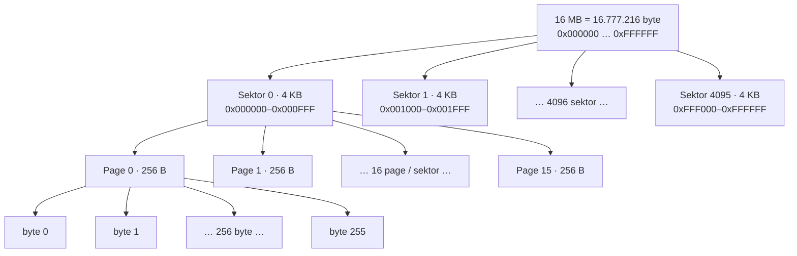
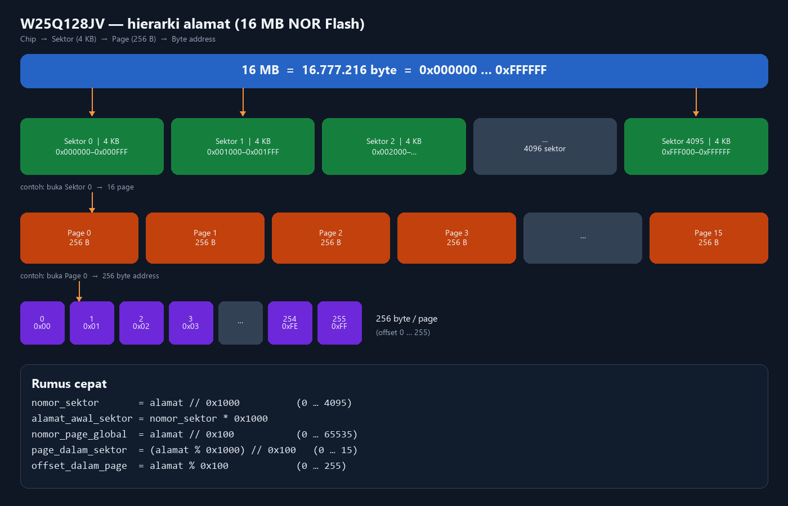

# W25Q128JVSIQ — alamat & sektor

Chip: **W25Q128JV** = 128 Mbit = **16 Mbyte** NOR SPI.  
Datasheet: [`U1_W25Q128JVSIQ_C113767.pdf`](U1_W25Q128JVSIQ_C113767.pdf) (Winbond Rev E).  
Pinout / rangkaian U1: [`W25Q128JVSIQ.md`](W25Q128JVSIQ.md).

Padanan 4 MB: `NRF52840/SCH_PCB_Design/Flash_W25Q32JVSSIQ/address-sector.md`.  
Yang berubah hanya ukuran chip. Ukuran page (256 B) dan sektor (4 KB) sama.

`Log_Session_Bin` dan `Log_Session_Bin_v3.1.1` **masih mengunci 4 MB** (`EF 40 16`, akhir `0x3FFFFF`). Bagian PLG1 di bawah adalah tata letak yang sama **jika logger diporting** ke chip ini, bukan perilaku firmware yang sedang berjalan.

---

## Parameter memori

| Parameter | Nilai |
|---|---|
| Rentang alamat byte | `0x000000` … `0xFFFFFF` |
| Ukuran total | 16 777 216 byte (16 MB) |
| **Sector erase** (CMD `20h`) | **4 KB** = `0x1000`. Datasheet tSE typ **45 ms**, max **400 ms** |
| **32 KB block erase** (CMD `52h`) | `0x8000`. tBE1 typ 120 ms, max 1 600 ms. **Tidak dipakai** uji / logger |
| **64 KB block erase** (CMD `D8h`) | `0x10000`. tBE2 typ 150 ms, max 2 000 ms. **Tidak dipakai** uji / logger |
| **Page program** (CMD `02h`) | **256 byte** = `0x100`. tPP typ 0,7 ms, max 3 ms |
| Jumlah sektor 4 KB | **4096** (indeks 0 … 4095) |
| Jumlah page | **65 536** (indeks 0 … 65 535) |
| Jumlah blok 64 KB | **256** (indeks 0 … 255) |
| **Chip erase** (`C7h` / `60h`) | tCE typ **40 s**, max **200 s** |
| JEDEC ID (`9Fh`) | **`EF 40 18`** |

Satu sektor = 16 page. Satu blok 64 KB = 16 sektor = 256 page.

### Konversi cepat

Pembagian di bawah adalah pembagian bulat.

```text
nomor_sektor       = alamat // 0x1000                 (0 … 4095)
alamat_awal_sektor = nomor_sektor * 0x1000
offset_dalam_sektor = alamat % 0x1000                 (0 … 4095)

nomor_page_global  = alamat // 0x100                  (0 … 65535)
page_dalam_sektor  = (alamat % 0x1000) // 0x100       (0 … 15)
offset_dalam_page  = alamat % 0x100                   (0 … 255)
```

| Alamat | Sektor | Arti |
|---|---|---|
| `0x1DC00` | **29** | offset `0xC00` di dalam sektor. Sama seperti contoh di catatan 4 MB |
| `0xFF0000` | **4080** | awal blok 64 KB terakhir (blok 255). Zona `TEST` project `Flash_W25Q128` |
| `0xFFF000` | **4095** | sektor terakhir, `0xFFF000`–`0xFFFFFF` |

---

## Peta yang dipakai sekarang

Hanya project uji SPI mentah. Logger belum menulis ke chip ini.

| Alamat | Sektor # | Pemakaian |
|---|---|---|
| `0xFF0000` – `0xFF0FFF` | **4080** | `Flash_W25Q128` perintah `TEST`: erase 4 KB + page program 16 byte + baca balik |

```text
0xFF0000 / 0x1000 = 4080
0x1000000 - 0xFF0000 = 64 KB sebelum akhir chip
```

`TEST` hanya menghapus **satu** sektor 4 KB, bukan seluruh blok 64 KB yang mulai di alamat yang sama.

---

## Peta PLG1 jika logger diporting (belum di firmware)

Filesystem sederhana **PLG1** (bukan FAT/LittleFS), pola yang sama dengan `Log_Session_Bin`:

| Alamat | Sektor # | Isi |
|---|---|---|
| `0x000000` – `0x000FFF` | **0** | Direktori: magic `PLG1`, daftar file (max 48), field `next_free` |
| `0x001000` – … | **1** … | Data file sesi. Header 256 B + record; v3.1.x = **26 B**/rekaman |
| `0xFFFFFF` | 4095, byte terakhir | Batas chip. Bukan `0x3FFFFF` |

### Arti `next_free`

`next_free` = **alamat byte pertama yang masih kosong** untuk file berikutnya.

| Nilai tipikal | Arti |
|---|---|
| `next_free=0x1000` | FS kosong / setelah `FORMAT` — data mulai di **sektor 1** |
| `next_free` naik | Setelah `STOP` sesi; file berikutnya ditulis dari alamat itu (di-align ke page 256 B) |

Sektor 0 **hanya katalog**, bukan sample.

---

## Diagram ringkas (16 MB)

```text
0x000000 ┬─ sektor 0 (4 KB) ── direktori PLG1, jika logger diporting
0x001000 ┼─ sektor 1 …        ── file .bin (next_free awal = di sini)
   …     │
0xFF0000 ┼─ sektor 4080       ── zona uji Flash_W25Q128 TEST
0xFFF000 ┼─ sektor 4095       ── sektor terakhir
0xFFFFFF ┴─ akhir chip
```

---

## Page vs sektor

| Unit | Ukuran | Perintah chip | Dipakai untuk |
|---|---|---|---|
| **Page** | **256 byte** | Page Program (`02h`) | Menulis data. Maks 256 B, dan tidak boleh melewati akhir page |
| **Sektor** | **4 KB** = **16 page** | Sector Erase (`20h`) | Mengosongkan fisik → semua byte jadi `0xFF` |

### Hierarki kotak (ASCII)

```text
┌─────────────────────────────────────────────────────────────────┐
│  16 MB  =  16.777.216 byte  =  0x000000 … 0xFFFFFF              │
└─────────────────────────────────────────────────────────────────┘
        │                    │                         │
        ▼                    ▼                         ▼
┌──────────────┐  ┌──────────────┐       ┌──────────────────────┐
│ Sektor 0     │  │ Sektor 1     │  …    │ Sektor 4095          │
│ 4 KB         │  │ 4 KB         │       │ 4 KB                 │
│ 0x000000–    │  │ 0x001000–    │       │ 0xFFF000–0xFFFFFF    │
│ 0x000FFF     │  │ 0x001FFF     │       │                      │
└──────────────┘  └──────────────┘       └──────────────────────┘
        │
        │  buka Sektor 0 → 16 page
        ▼
┌─────────┐ ┌─────────┐ ┌─────────┐     ┌──────────┐
│ Page 0  │ │ Page 1  │ │ Page 2  │ …   │ Page 15  │
│ 256 B   │ │ 256 B   │ │ 256 B   │     │ 256 B    │
└─────────┘ └─────────┘ └─────────┘     └──────────┘
        │
        │  buka Page 0 → 256 alamat byte
        ▼
┌───┐┌───┐┌───┐┌───┐     ┌────┐┌────┐
│ 0 ││ 1 ││ 2 ││ 3 │ …   │254 ││255 │
└───┘└───┘└───┘└───┘     └────┘└────┘
```

### Hierarki (Mermaid)



### Hierarki (PNG)



Aturan NOR yang menentukan desain logger:

- Program hanya bisa mengubah bit **1 → 0**. Tidak bisa menimpa page yang sudah berisi tanpa erase.
- Erase terkecil yang dipakai = **satu sektor penuh** (16 page ikut bersih). Tidak ada hapus satu page saja.

---

## Cara menulis satu file `.bin` (header + data)

Sama dengan logger 4 MB. Ukuran chip tidak mengubah bentuk file.

| Bagian | Ukuran | Isi |
|---|---|---|
| **Header** | **256 B** = **1 page** | Magic `PLG1`, `period_ms`, `start_name`, `start_unix_ms`, dll. |
| **Data** | **N × ukuran rekaman** | v3.1.x: **26 B** (`t_rel_ms` + kanal) |

1. Sample ditumpuk di buffer RAM.
2. Saat buffer mencapai **256 B**, firmware page-program ke flash.
3. Sebelum menulis ke sektor yang belum bersih, firmware harus sector-erase dulu.

Jika `STOP` terjadi sebelum page penuh, sisa page tetap `0xFF`. Reader memakai `byte_size`, bukan padding itu. File berikutnya di-align ke **batas page 256 B**, bukan wajib ke batas sektor. Satu `.bin` boleh menempati beberapa sektor beruntun.

---

## Dua file berbagi satu sektor

Karena align hanya ke page, akhir file A dan awal file B boleh berada di sektor yang sama.

```text
SEKTOR A (16 page)
  page 0 … 9     ← bagian akhir  file_bin_1
  page 10 … 15   ← bagian awal   file_bin_2

SEKTOR B (16 page)
  page 0 … 15    ← lanjutan      file_bin_2
```

Sector-erase sektor A untuk “menghapus” `bin_1` ikut menghapus awal `bin_2`. Karena itu DELETE di logger **tidak** meng-erase sektor data.

---

## DELETE vs FORMAT

Berlaku untuk `Log_Session_Bin` pada chip 4 MB. Belum ada padanannya di firmware 16 MB. Aturannya tetap sama jika diporting.

### DELETE

Hanya mengubah katalog di sektor 0: entri ditandai bebas dan hilang dari `LIST`. Byte file di flash tidak diubah. `next_free` mundur hanya jika file yang dihapus ada di ujung alokasi. Ruang di tengah tidak dipakai ulang, karena menulis ulang butuh sector erase dan sektor itu mungkin masih dibagi file lain.

### FORMAT

| Langkah | Efek pada chip ini |
|---|---|
| **Chip erase** | Seluruh **16 MB** kembali ke `0xFF`. Datasheet typ **40 s**, max **200 s** — lebih lama dari chip 4 MB |
| **Init FS** | Direktori PLG1 baru di sektor 0; `next_free = 0x1000` |
| **Semua file** | Hilang |

| Aksi | Direktori | Data | File tetangga | Kapasitas kembali |
|---|---|---|---|---|
| **DELETE** satu file | Entri dihapus | Data lama tetap | Aman | Hanya jika file di ujung |
| **Sector erase** pada sektor bersama | — | Sektor itu `0xFF` | Rusak | Ya, tetapi merusak tetangga |
| **FORMAT** | Diganti baru | Seluruh 16 MB `0xFF` | Semua hilang | Ya, dari `0x1000` |

Meng-erase **sektor 0** menghapus seluruh direktori.

---

## Dampak sector erase pada sampling 10 ms

Stall tidak bertambah hanya karena chip menjadi 16 MB. Yang memblok sampling adalah **erase satu sektor 4 KB** (typ 45 ms, max 400 ms), dan ukuran sektor tidak berubah.

Pada rekaman 26 B, satu sektor masih menampung sekitar **157 sampel** (~1,6 s pada 100 Hz). Gejala di firmware ≤ v3.1.0 tetap sama: lonjakan `t_rel_ms` tiap ~4 KB, lalu beberapa sampel dengan Δt 0, sementara jumlah rekaman tetap lengkap.

Solusi yang sudah ada di `Log_Session_Bin_v3.1.1`, dan yang perlu ikut saat port ke 16 MB:

| Bagian | Peran |
|---|---|
| Timer 10 ms + ring buffer | Capture tidak menunggu SPI |
| `erasedUntil = FLASH_SIZE` setelah chip erase | Siklus FORMAT lalu append tidak memanggil sector erase lagi |

Saat diporting, `FLASH_SIZE` harus **16 MB** (`0x1000000`), bukan 4 MB. Jika konstanta lama tertinggal, logger berhenti di `0x400000` padahal chip masih punya 12 MB kosong, atau menolak JEDEC `EF 40 18`.

---

## Opsi desain yang belum dipakai

Skema sekarang: align ke page 256 B, DELETE = unlink katalog, lubang di tengah tidak dipakai ulang sampai FORMAT atau hapus di ujung.

Alternatif yang sama dengan catatan 4 MB:

1. Alokasi dibulatkan ke kelipatan sektor 4 KB, supaya sector erase satu file tidak mengenai tetangga.
2. Compaction saat DELETE, supaya file di belakang digeser dan `next_free` mundur.

Keduanya menambah waktu, keausan flash, dan risiko mati listrik di tengah geser. Untuk pola unduh lalu FORMAT, skema unlink yang sekarang sudah cukup. Ini belum diimplementasikan, baik di logger 4 MB maupun di chip 16 MB.
