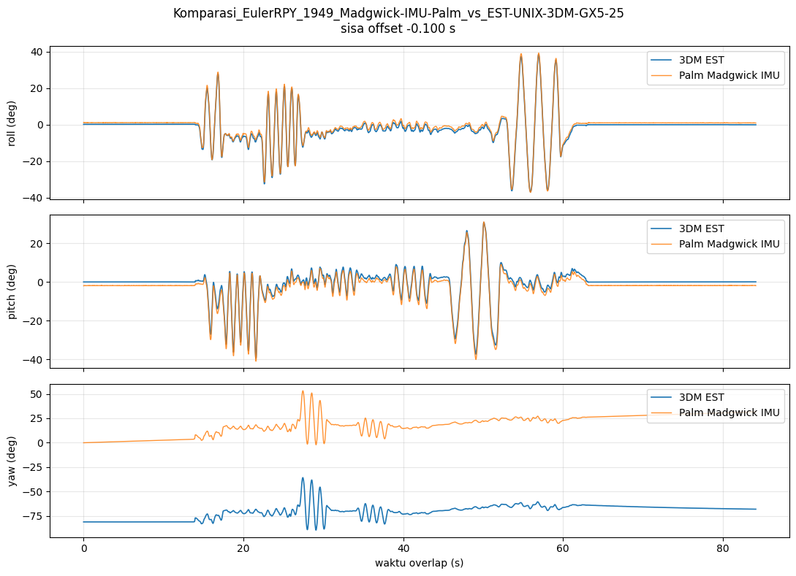
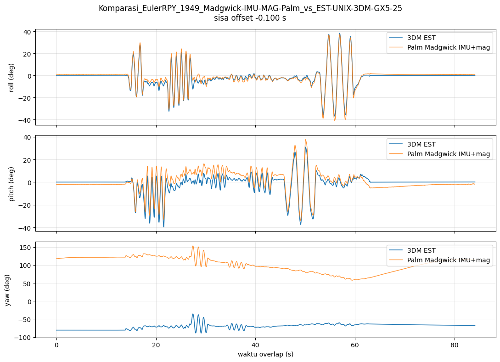
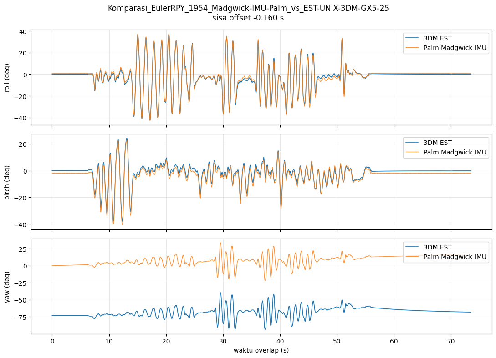
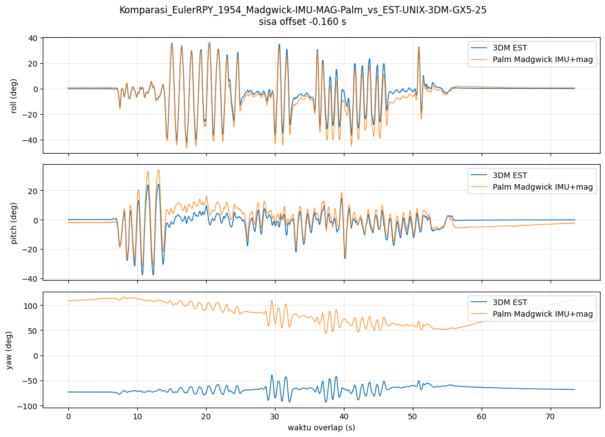

# Resume komparasi Euler RPY

**Madgwick Palm vs EST Unix 3DM-GX5-25**

Tanggal data: 9 November 2026. Dua sesi, 19:49 dan 19:54 WIB.

## Tujuan

Membandingkan roll, pitch, dan yaw Palm terhadap estimasi orientasi 3DM-GX5-25. Palm belum menyimpan Euler, jadi sudut dihitung di Python dengan `ahrs` 0.4.

Dua filter diuji pada masing-masing sesi:

- Madgwick IMU: akselerometer dan giroskop. Gain bawaan **0,033**.
- Madgwick IMU+Mag: akselerometer, giroskop, dan magnetometer mentah. Gain bawaan MARG **0,041**.

## Data

| Sesi | Palm | 3DM-GX5-25 EST | Sampel Palm | Laju |
|---|---|---|---:|---:|
| 1949 | `261109194905.bin` | `SensorConnectData_EST_Unix_1949.csv` | 8617 | 100 Hz |
| 1954 | `261109195407.bin` | `SensorConnectData_EST_Unix_1954.csv` | 7527 | 100 Hz |

Format Palm adalah PLG1 v4. Rekaman 26 byte: waktu relatif, lalu accel (mg), gyro (0,1 °/s), dan mag (µT). Sudut EST sudah dalam radian.

Notebook ada di folder yang sama:

- `Komparasi_EulerRPY_1949_Madgwick-IMU-Palm_vs_EST-UNIX-3DM-GX5-25.ipynb`
- `Komparasi_EulerRPY_1949_Madgwick-IMU-MAG-Palm_vs_EST-UNIX-3DM-GX5-25.ipynb`
- `Komparasi_EulerRPY_1954_Madgwick-IMU-Palm_vs_EST-UNIX-3DM-GX5-25.ipynb`
- `Komparasi_EulerRPY_1954_Madgwick-IMU-MAG-Palm_vs_EST-UNIX-3DM-GX5-25.ipynb`

## Cara hitung

Sumbu mengikuti catatan uji: X tetap, Y dan Z dibalik, untuk accel, gyro, dan mag. Setelah remap, Z Palm sekitar −1 g, sama seperti gaya spesifik 3DM.

`ahrs` pada kerangka NED membandingkan akselerometer dengan acuan `[0, 0, +1]`. Karena sensor membaca gaya spesifik, tanda akselerasi dibalik hanya sebelum masuk Madgwick. Gyro dan mag tidak ikut dibalik.

Magnetometer dipakai mentah, tanpa kalibrasi hard-iron atau soft-iron.

Jam di header Palm adalah jam dinding WIB yang tersimpan sebagai angka Unix. EST SensorConnect adalah Unix UTC, selisih 7 jam. Waktu Palm digeser −7 jam, lalu sisa offset dicari pada rentang ±5 detik agar korelasi pitch maksimum. Seluruh sampel Palm masuk jendela EST.

Selisih sudut dibungkus ke (−180°, 180°]. Baris “setelah bias” mengurangi rata-rata selisih itu.

## Sesi 1949

Sisa offset waktu **−0,100 detik** untuk kedua filter.

| Filter | Sumbu | Korelasi | MAE | RMSE | Bias | MAE setelah bias |
|---|---|---:|---:|---:|---:|---:|
| Madgwick IMU | Roll | 0,999 | 0,99° | 1,05° | +0,97° | 0,25° |
| Madgwick IMU | Pitch | 0,999 | 1,72° | 1,78° | −1,72° | 0,31° |
| Madgwick IMU | Yaw | 0,935 | 88,7° | 88,8° | +88,7° | 3,30° |
| Madgwick IMU+Mag | Roll | 0,985 | 1,32° | 1,67° | +0,55° | 1,13° |
| Madgwick IMU+Mag | Pitch | 0,871 | 4,04° | 4,63° | +1,67° | 3,95° |
| Madgwick IMU+Mag | Yaw | −0,410 | 159° | 160° | +7,7° | 157° |

## Sesi 1954

Sisa offset waktu **−0,160 detik** untuk kedua filter.

| Filter | Sumbu | Korelasi | MAE | RMSE | Bias | MAE setelah bias |
|---|---|---:|---:|---:|---:|---:|
| Madgwick IMU | Roll | 0,995 | 1,03° | 1,25° | +0,31° | 0,92° |
| Madgwick IMU | Pitch | 0,992 | 1,61° | 1,72° | −1,47° | 0,64° |
| Madgwick IMU | Yaw | 0,901 | 76,0° | 76,1° | +76,0° | 2,41° |
| Madgwick IMU+Mag | Roll | 0,972 | 2,85° | 4,06° | −2,20° | 2,82° |
| Madgwick IMU+Mag | Pitch | 0,851 | 4,05° | 4,60° | +1,73° | 3,72° |
| Madgwick IMU+Mag | Yaw | −0,158 | 151° | 152° | +91,0° | 61,2° |

## Kesimpulan

Madgwick IMU mengikuti roll dan pitch EST di kedua sesi. MAE roll dan pitch sekitar 1–2°. Setelah bias konstan dihilangkan, sisa roll dan pitch di sesi 1949 di bawah 0,3°.

Yaw Madgwick IMU mengikuti bentuk gerak. Korelasi 0,935 (1949) dan 0,901 (1954). Offset heading sekitar +89° pada sesi 1949 dan +76° pada sesi 1954. Setelah offset itu dihilangkan, MAE yaw 3,30° (1949) dan 2,41° (1954).

Magnetometer mentah tidak memperbaiki yaw. Korelasi yaw menjadi negatif, −0,410 (1949) dan −0,158 (1954), dan MAE tetap di atas 150°. Pitch juga merosot: korelasi turun dari 0,999 dan 0,992 menjadi 0,871 dan 0,851. Roll masih mengikuti, dengan MAE 1,32° dan 2,85°. Heading dari mag belum dapat dipakai sebelum kalibrasi hard-iron/soft-iron.
