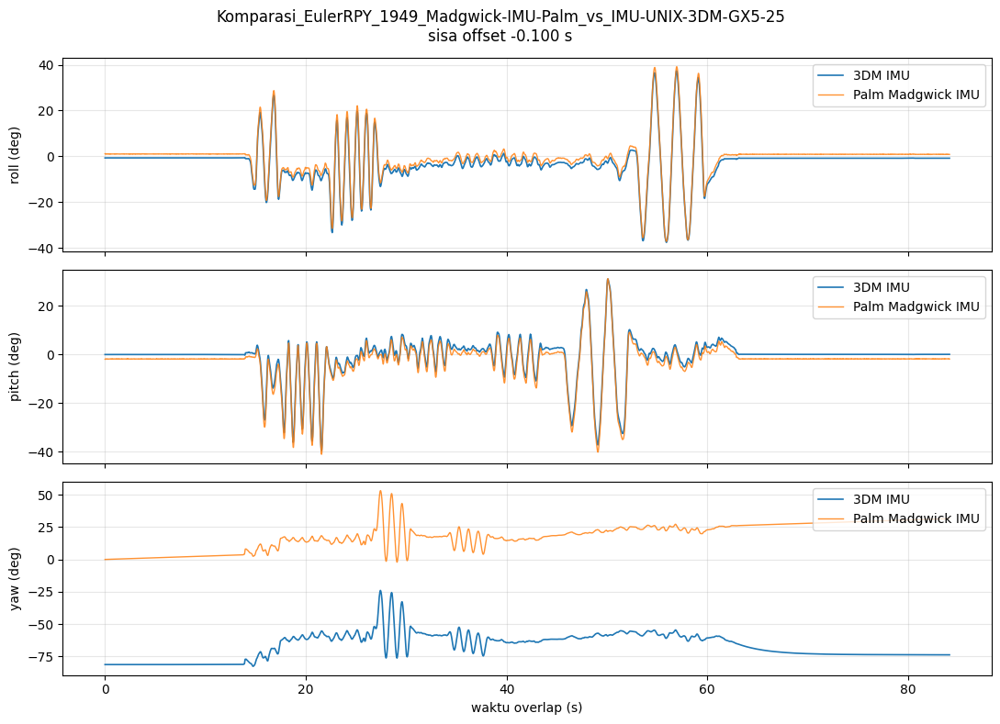
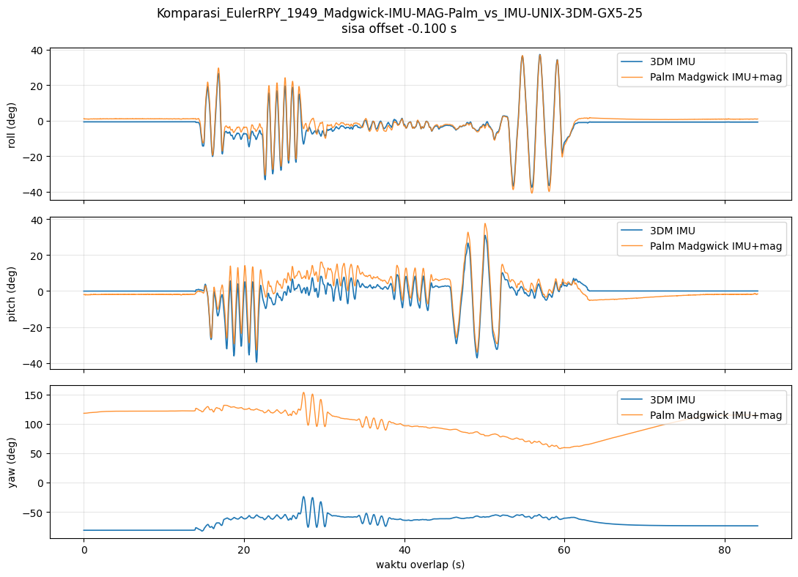
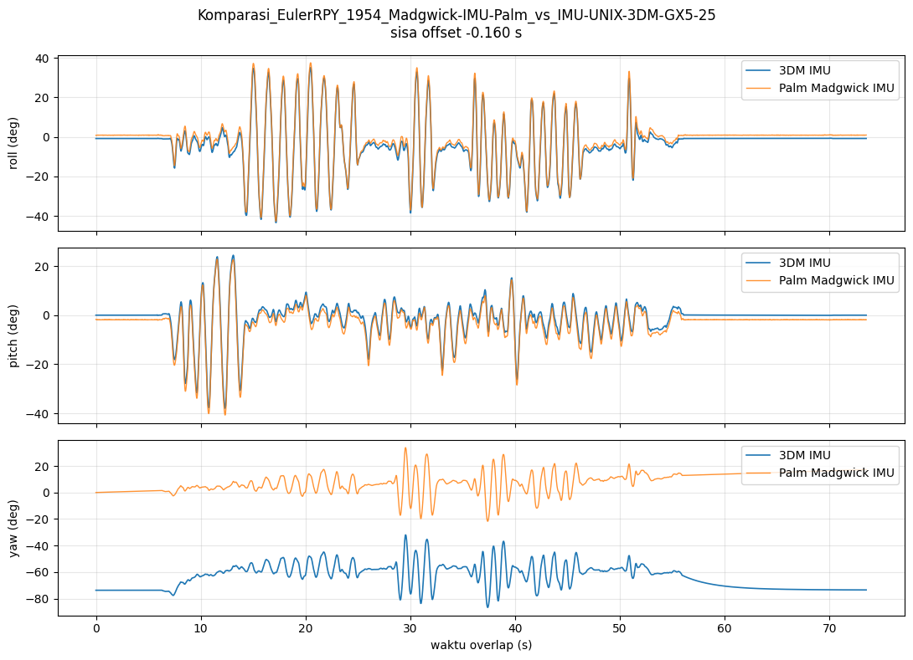
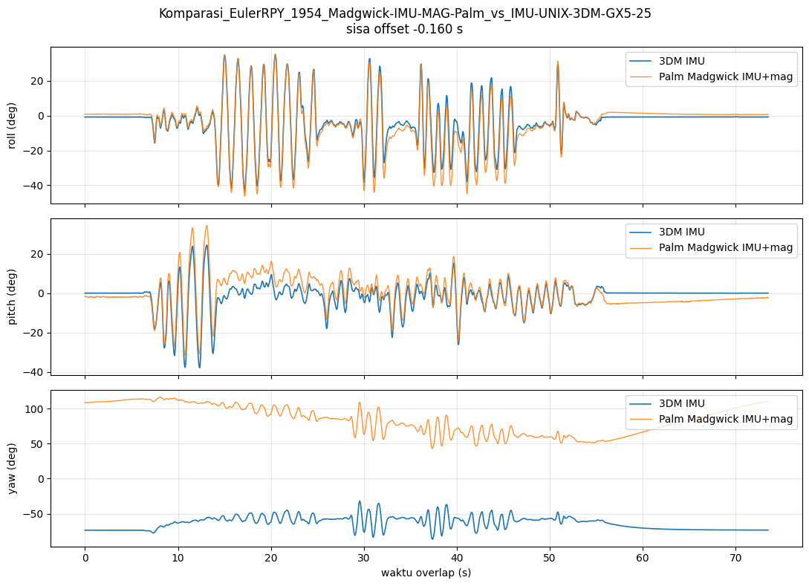

# Resume komparasi Euler RPY

**Madgwick Palm vs IMU Unix 3DM-GX5-25**

Tanggal data: 9 November 2026. Dua sesi, 19:49 dan 19:54 WIB. Acuan sudut adalah kolom `roll`, `pitch`, dan `yaw` pada berkas IMU 3DM, bukan estimasi EST.

## Tujuan

Membandingkan roll, pitch, dan yaw Palm terhadap sudut IMU 3DM-GX5-25. Palm belum menyimpan Euler, jadi sudut dihitung di Python dengan `ahrs` 0.4.

Dua filter diuji pada masing-masing sesi:

- Madgwick IMU: akselerometer dan giroskop. Gain bawaan **0,033**.
- Madgwick IMU+Mag: akselerometer, giroskop, dan magnetometer mentah. Gain bawaan MARG **0,041**.

## Data

| Sesi | Palm | 3DM-GX5-25 IMU | Sampel Palm | Laju |
|---|---|---|---:|---:|
| 1949 | `261109194905.bin` | `SensorConnectData_IMU_Unix_1949.csv` | 8617 | 100 Hz |
| 1954 | `261109195407.bin` | `SensorConnectData_IMU_Unix_1954.csv` | 7527 | 100 Hz |

Format Palm adalah PLG1 v4. Rekaman 26 byte: waktu relatif, lalu accel (mg), gyro (0,1 °/s), dan mag (µT). Sudut IMU 3DM dalam radian.

Notebook ada di folder yang sama:

- `Komparasi_EulerRPY_1949_Madgwick-IMU-Palm_vs_IMU-UNIX-3DM-GX5-25.ipynb`
- `Komparasi_EulerRPY_1949_Madgwick-IMU-MAG-Palm_vs_IMU-UNIX-3DM-GX5-25.ipynb`
- `Komparasi_EulerRPY_1954_Madgwick-IMU-Palm_vs_IMU-UNIX-3DM-GX5-25.ipynb`
- `Komparasi_EulerRPY_1954_Madgwick-IMU-MAG-Palm_vs_IMU-UNIX-3DM-GX5-25.ipynb`

## Cara hitung

Sama dengan perbandingan terhadap EST. Sumbu Palm: X tetap, Y dan Z dibalik. Tanda akselerasi dibalik hanya sebelum masuk Madgwick. Gyro dan mag tidak ikut dibalik. Magnetometer mentah, tanpa kalibrasi hard-iron atau soft-iron.

Waktu Palm digeser −7 jam, lalu sisa offset dicari pada rentang ±5 detik agar korelasi pitch maksimum. Selisih sudut dibungkus ke (−180°, 180°]. Baris “setelah bias” mengurangi rata-rata selisih itu.

## Sesi 1949

Sisa offset waktu **−0,100 detik** untuk kedua filter.

| Filter | Sumbu | Korelasi | MAE | RMSE | Bias | MAE setelah bias |
|---|---|---:|---:|---:|---:|---:|
| Madgwick IMU | Roll | 0,999 | 1,71° | 1,75° | +1,71° | 0,21° |
| Madgwick IMU | Pitch | 0,999 | 1,75° | 1,81° | −1,75° | 0,30° |
| Madgwick IMU | Yaw | 0,511 | 85,3° | 85,9° | +85,3° | 8,16° |
| Madgwick IMU+Mag | Roll | 0,983 | 1,74° | 2,11° | +1,28° | 1,22° |
| Madgwick IMU+Mag | Pitch | 0,873 | 3,99° | 4,59° | +1,64° | 3,90° |
| Madgwick IMU+Mag | Yaw | −0,255 | 158° | 159° | +28,4° | 141° |

## Sesi 1954

Sisa offset waktu **−0,160 detik** untuk kedua filter.

| Filter | Sumbu | Korelasi | MAE | RMSE | Bias | MAE setelah bias |
|---|---|---:|---:|---:|---:|---:|
| Madgwick IMU | Roll | 0,999 | 1,60° | 1,69° | +1,59° | 0,39° |
| Madgwick IMU | Pitch | 0,998 | 1,81° | 1,87° | −1,81° | 0,32° |
| Madgwick IMU | Yaw | 0,368 | 71,6° | 72,2° | +71,6° | 7,88° |
| Madgwick IMU+Mag | Roll | 0,980 | 2,40° | 3,18° | −0,92° | 2,52° |
| Madgwick IMU+Mag | Pitch | 0,848 | 3,80° | 4,51° | +1,38° | 3,69° |
| Madgwick IMU+Mag | Yaw | −0,073 | 146° | 148° | +96,2° | 51,6° |

## Kesimpulan

Terhadap sudut IMU 3DM, Madgwick tanpa magnetometer tetap lebih baik. Roll dan pitch berkorelasi 0,998–0,999. Setelah bias konstan dihilangkan, MAE roll dan pitch di bawah 0,4°.

Yaw tanpa magnetometer hanya berkorelasi 0,511 (1949) dan 0,368 (1954). Offset heading +85° dan +72°. Setelah offset dihilangkan, MAE yaw masih 8,16° dan 7,88°, lebih besar daripada sisa terhadap EST.

Magnetometer mentah memperburuk pitch dan membuat korelasi yaw negatif atau mendekati nol.
